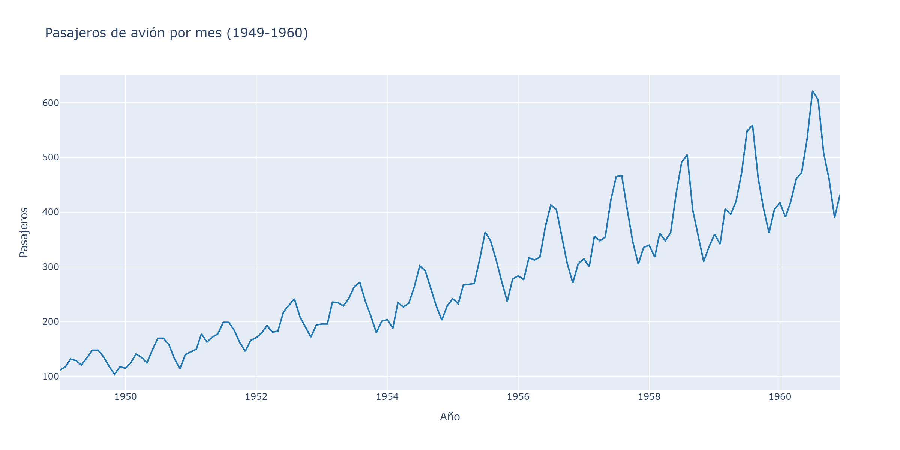
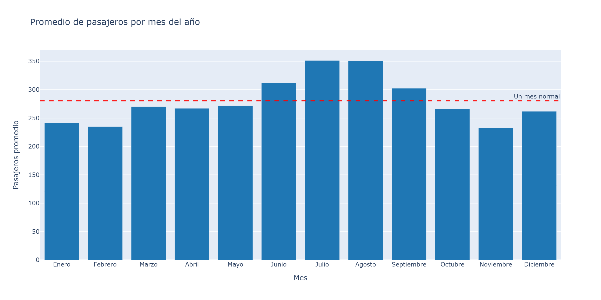
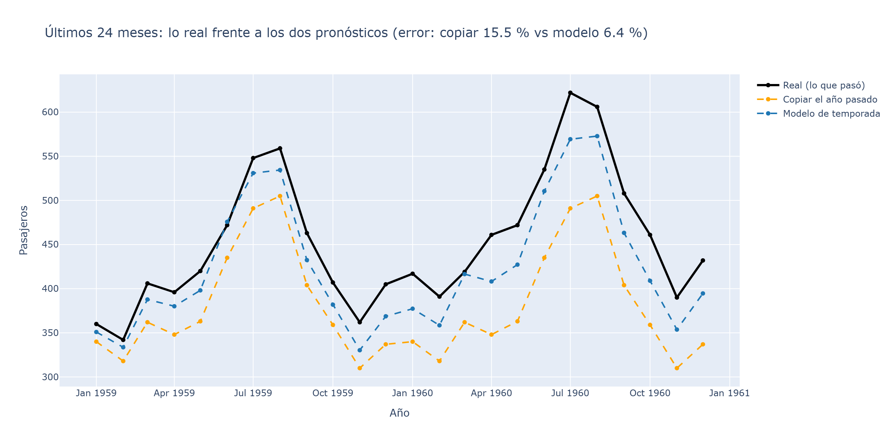
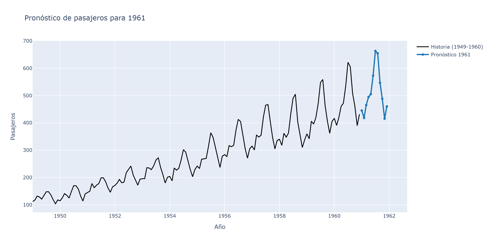
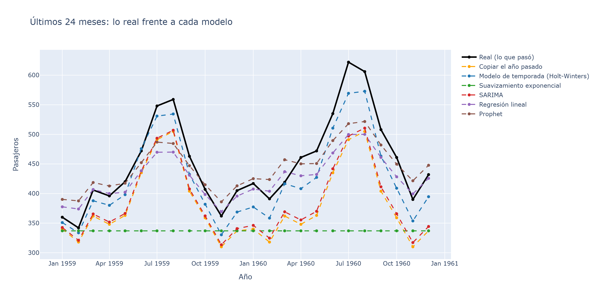
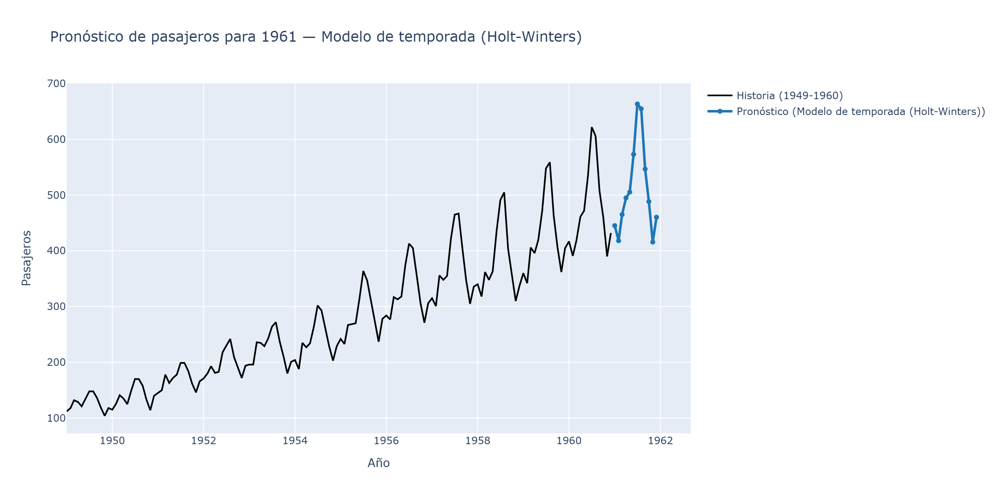
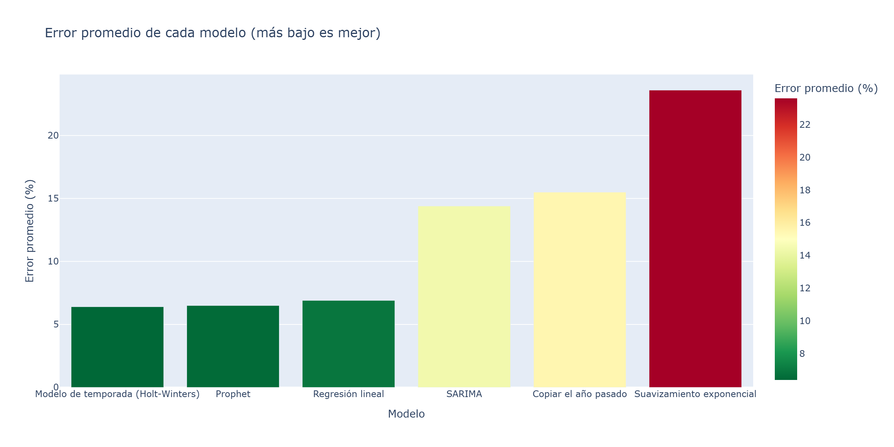

# ¿Cuántos pasajeros tendremos el próximo año?

Aplicación sencilla hecha con **Streamlit** para analizar y pronosticar los
pasajeros mensuales de avión entre **1949 y 1960**, usando varios modelos de
series de tiempo.

## ¿Qué hace?

- **La historia**: muestra los pasajeros mes a mes.
- **La temporada**: promedio de cada mes del año (enero a diciembre) comparado
  con un "mes normal", para ver temporada alta y baja.
- **El examen**: esconde los últimos 24 meses y los pronostica de **dos formas**
  para ver cuál se equivoca menos.
- **El pronóstico**: pronostica los 12 meses de **1961** con el Modelo de
  temporada (Holt-Winters).
- **Más modelos**: compara **seis formas** de pronosticar y te deja elegir con
  cuál pronosticar 1961.

## Gráficos

Los gráficos de la app también quedan guardados como imágenes en la carpeta
`graficos/` (en PNG y en HTML interactivo). Para regenerarlos:

```bash
uv run python generar_graficos.py
```

### 1. La historia



### 2. La temporada



### 3. El examen



### 4. El pronóstico



### 5. Más modelos



### 6. Pronóstico con el modelo ganador



### 7. Error de cada modelo (gráfico de barras)



## Los modelos de pronóstico

El **examen** (pestaña 3) compara estas dos formas:

| Forma | Descripción |
|---|---|
| Copiar el año pasado | Cada mes igual al mismo mes del último año visible |
| Modelo de temporada (Holt-Winters) | Tendencia aditiva + temporada multiplicativa (12 meses) |

La pestaña **Más modelos** añade cuatro modelos más:

| Modelo | Descripción |
|---|---|
| Suavizamiento exponencial | Promedio con más peso a lo reciente (sin temporada) |
| SARIMA | Modelo clásico con tendencia y temporada |
| Regresión lineal | Recta en el tiempo + ajuste por mes |
| Prophet | Modelo de Meta que maneja tendencia y temporada solo |

## Requisitos

- **Python 3.12** o superior
- **uv** (recomendado): https://docs.astral.sh/uv/

## Instalación

Desde la carpeta del proyecto:

```bash
uv sync
```

Esto crea el entorno `.venv` e instala todas las dependencias
(streamlit, pandas, plotly, statsmodels, prophet y kaleido).

## Cómo ejecutar

**Opción 1 (fácil):** doble clic en `iniciar_app.bat`.

**Opción 2 (terminal):**

```bash
uv run streamlit run app.py
```

Luego abre en tu navegador: **http://127.0.0.1:8501**

> Para detenerla, cierra la ventana de la terminal o pulsa `Ctrl + C`.

## Archivos del proyecto

```
app.py                      La aplicación (pestañas, gráficos y modelos)
datos.py                    Carga los datos (internet o archivo local)
generar_graficos.py         Guarda los gráficos como imágenes en graficos/
prueba_datos.py             Prueba rápida de los datos
iniciar_app.bat             Atajo para abrir la app en Windows
pyproject.toml              Dependencias del proyecto
.streamlit/config.toml      Configuración (fuerza IPv4 y sin telemetría)
Datos/airline-passengers.csv  Datos de respaldo (si no hay internet)
graficos/                   Imágenes PNG y HTML de los gráficos
```

## Los datos

La app intenta bajar los datos de internet
(`jbrownlee/Datasets`) y, si no hay conexión, usa el archivo local
`Datos/airline-passengers.csv`. Las columnas son `Month` y `Passengers`.

## Notas

- La app se enlaza a **IPv4** (`127.0.0.1`) para evitar un problema de Windows
  con IPv6 que rompía el servidor.
- Todo el texto de la app está en **español** y pensado para principiantes.
